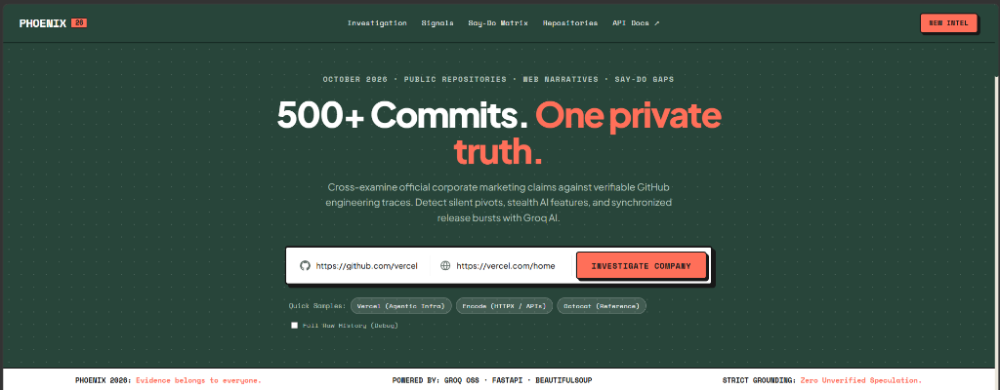
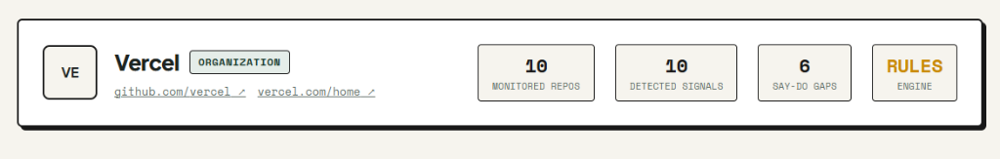
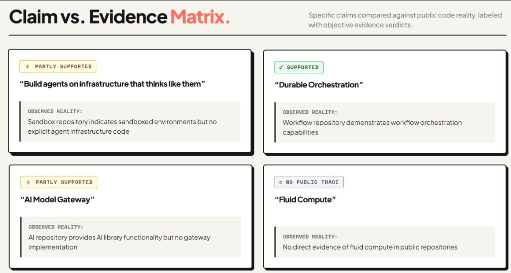

# Phoenix — Competitive Engineering Intelligence

> **Turn scattered public footprints into actionable competitive intelligence.**
> See what a tech company is building before it announces it.



---

## The Story Behind Phoenix

Imagine you're a startup founder trying to figure out what your competitors are doing. You'd have to dig through their GitHub repos, job postings, websites, and social media, then connect all the dots yourself. And even after all that, you're still mostly guessing.

**That's why I built Phoenix.**

The current prototype investigates a company's GitHub activity and compares its engineering work with what it claims on its website. The bigger vision is to bring in job postings and social media too.

Imagine a company starts hiring blockchain engineers, its GitHub shows blockchain-related development, and a few months later it announces a new blockchain product. What if you could connect those signals earlier?

**That's what Phoenix aims to do: turn scattered public information into competitive intelligence, helping founders spend less time digging and more time planning their next move.**

---

## How It Works

Phoenix takes a GitHub organization URL and a company website URL, runs a multi-stage investigation, and uncovers the gaps between marketing promises and actual code commits:

1. **GitHub Activity Analysis:** Ingests public repositories, 45-day commit velocity, and burst pacing.
2. **Website Claim Extraction:** Pulls official product claims and marketing taglines.
3. **Say-Do Synthesis:** Cross-examines website claims against public commit reality using Groq AI.

### Company Overview & Signals



### Claim vs. Evidence Matrix



---

## Quickstart & Setup

### Prerequisites
- Python 3.11+
- Node.js 18+ and npm
- Groq API Key (https://console.groq.com)
- Optional: GitHub Personal Access Token (avoids GitHub rate limits)

### 1. Environment Setup

```bash
git clone https://github.com/GoLu-Jii/PhoeniX.git
cd PhoeniX
cp .env.example .env
```

Configure `.env`:
```env
GITHUB_TOKEN=your_github_token_here
GROQ_API_KEY=your_groq_api_key_here
GROQ_MODEL=llama-3.3-70b-versatile
```

### 2. Backend (FastAPI)

```bash
python -m venv .venv

# Windows
.\.venv\Scripts\Activate.ps1
# Linux / macOS
source .venv/bin/activate

pip install -r requirements.txt
python -m uvicorn app.main:app --reload --app-dir backend --port 8000
```

Backend runs at `http://127.0.0.1:8000` (docs at `/docs`).

### 3. Frontend (React 19 + Vite)

In a second terminal:

```bash
cd frontend
npm install
npm run dev
```

Open `http://localhost:5173` in your browser.

---

## API Endpoints

- `GET /health` - Service health check
- `POST /api/investigations` - Complete company investigation (GitHub + Website + Say-Do matrix)
- `POST /api/signals` - GitHub commit analysis and burst signals
- `POST /api/analyze` - Say-Do synthesis on pre-extracted data

---

## Tests

```bash
# Backend tests
pytest backend/tests -v

# Frontend lint & build
cd frontend
npm run lint
npm run build
```

---

## Future Roadmap

- Job board and hiring wave tracking (Greenhouse, Lever, LinkedIn)
- Release and changelog diff monitoring
- Launch timeline predictions
- Automated competitor shift alerts

---

## License

MIT (c) 2026 Phoenix Contributors. Built for competitive intelligence & open-source verification.