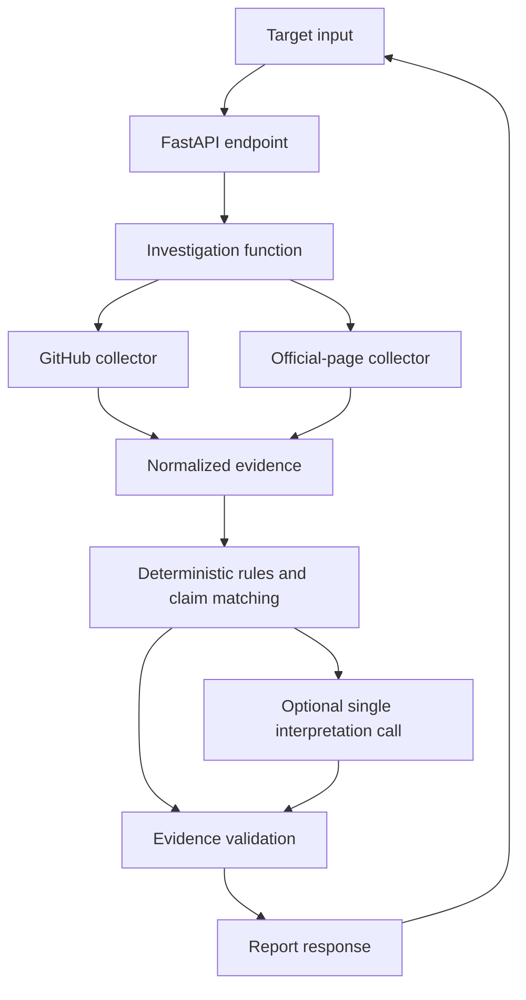

# PHOENIX — Architecture

## Principle

Build one modular application, not a system of services. Keep only the boundaries that protect the core pipeline: collection, evidence, detection, interpretation, verification, and reporting.

## End-to-end flow

These are logical responsibilities, not separate processes. The MVP default is a bounded, sequential request flow with synchronous HTTPX calls. Add async/concurrency only if measured scan time makes it necessary; do not add complexity pre-emptively.

## Request lifecycle

1. **Validate the target.** Accept a supported GitHub account URL or an HTTP(S) company website URL. Reject malformed inputs and unsafe local/private destinations.
2. **Resolve only obvious sources.** A direct GitHub target needs no website discovery. For a company website, inspect the homepage and a small number of official links. Do not guess a GitHub account from a name alone.
3. **Collect within limits.** Use explicit timeouts, page/repository caps, and bounded retries. One source failing must not discard successful records from another.
4. **Normalize evidence.** Keep the original source URL, an event date only when it is known, collection time, and fields needed by detectors.
5. **Detect.** Pure Python rules create candidate findings from the normalized records. Do not ask the LLM to calculate dates, counts, or thresholds.
6. **Compare claims.** When official text is available, compare only specific claims with relevant evidence. If coverage is inadequate, use `insufficient_evidence`.
7. **Interpret and validate.** An optional single LLM call explains candidates. The backend validates all evidence IDs and attaches authoritative URLs itself. If the model is unavailable or malformed, return deterministic results.
8. **Return the report.** Include findings, source status, evidence details, and warnings. Empty findings can be a valid completed scan.

## Minimal API

- `GET /api/health`: lightweight health check.
- `POST /api/investigations`: accepts `{ "target_url": "https://..." }` and returns the investigation report.

Do not add optional request switches until a real UI or test needs them. The first API can return the report directly; no database, polling, or job queue is required.

## Source and URL safety

Because a user-supplied website may be fetched, enforce the basics from the start: HTTP(S) only, reject localhost/private/link-local/reserved targets, revalidate redirects, cap response size and page count, and apply timeouts. Only follow links discovered on the validated official pages; do not offer arbitrary URL fetching as a feature. Treat fetched page text as untrusted input and possible prompt injection. The LLM has no tools and must not change collection scope, create URLs, or receive secrets.

## Configuration

Use environment variables only for settings the code actually needs, such as an optional GitHub token, optional LLM key/model, CORS origins, and request limits. Never expose secrets to the browser or logs. The core collector, detector, and test suite must run without an LLM key.

## Persistence and operations

No database, scheduler, background queue, authentication, or long-lived history in the first version. Add persistence only if an actual demo/product requirement cannot be met with a request-scoped report.
