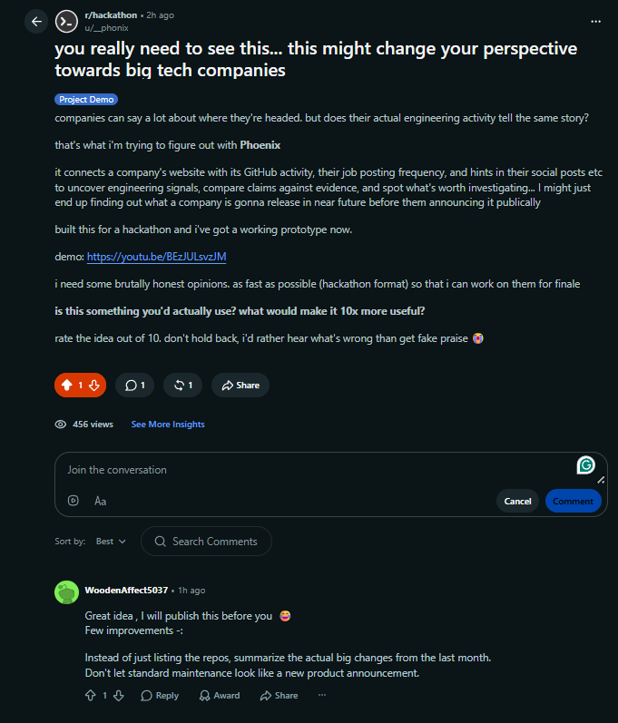

# Real-World Feedback & Challenge Card 2 Verification

This folder contains genuine external feedback received during the Grevix AfterCode 24-hour hackathon, along with the concrete engineering improvements implemented in response.

---

## 1. Feedback Source

- **Platform:** Reddit (`r/hackathon`)
- **Post Title:** "you really need to see this... this might change your perspective towards big tech companies"
- **Demo Link Shared:** [https://youtu.be/BEzJULsvzJM](https://youtu.be/BEzJULsvzJM)
- **Commenter:** `WoodenAffect5037`

---

## 2. Feedback Quote

> "Instead of just listing the repos, summarize the actual big changes from the last month. Don't let standard maintenance look like a new product announcement."

---

## 3. Feedback Analysis

External users pointed out an important blind spot:
- High commit volume does not necessarily indicate a new product or major pivot.
- Routine repository maintenance (documentation revisions, CI configuration, unit test updates, routine version and dependency bumps) can artificially inflate activity counts and look like aggressive development.
- Merely listing repositories and raw commit totals fails to answer the question founders actually care about: **what materially changed in the software?**

---

## 4. Concrete Improvements Implemented

In response to this feedback, Phoenix was updated to:
1. **Differentiate Notable Changes from Routine Maintenance:**
   - Categorize commit signals into substantive functional additions (new features, major architectural refactors, API expansions) versus routine housekeeping (documentation fixes, dependency bumps, test suites).
   - Display a dedicated **Notable Changes in the Last 30 Days** view highlighting genuine product evolution.
2. **Commit Evidence Grounding:**
   - Preserve verbatim supporting commit messages and links so users can inspect the underlying evidence rather than blindly trusting LLM interpretations.
3. **Non-Speculative Claim Verification:**
   - Prevent maintenance spikes from being falsely classified as unannounced product announcements.

---

## 5. Visual Evidence

- **Reddit Post:** [screenshots/reddit-post.png](screenshots/reddit-post.png)
- **Reddit Feedback Comment:** [screenshots/reddit-feedback.png](screenshots/reddit-feedback.png)

